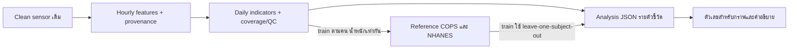

# Daily cohort-reference baseline — v1

เป้าหมายคือวัด **ความห่างของตัวชี้วัดรายวันจาก reference COPS และ NHANES แยกกัน** ไม่ใช่ classifier, โอกาสเป็นโรค หรือคะแนนความรุนแรง และไม่มีการรวมหลายตัวชี้วัดเป็นคะแนนเดียว ข้อความ/กราฟในระบบปลายทางต้องใช้คำว่า “ต่างจากกลุ่มอ้างอิง COPS/NHANES” เท่านั้น

## Real-data run — 23 ต.ค. 2026

ใช้ **ทางที่ 2: clean ใหม่จาก raw** เพราะค้น S3 clean/features/raw และ prefixes metadata/config/reports/logs/manifests รวมประวัติ Git และ QC ของ train/validation 110 ไฟล์แล้ว ไม่พบ config/code/output linkage ของ clean/features เดิม `_source.json` 42 ไฟล์บอกเพียง acquisition source/size/file count ไม่ยืนยัน preprocessing ห้ามใช้การตรงกันของ MD5 หรือ config ปัจจุบันแทนหลักฐานย้อนหลัง

รอบใหม่ `real-20261023-v1` เรียก `src.clean.run.clean_subject/write_parquet`, `tools.extract_reference_features.extract`, daily/fit/analysis เดิมผ่าน `tools/run_real_reference.py` ไม่มีการเปลี่ยนเกณฑ์ clean/QC, สูตร feature, split หรือสร้าง ingestion ใหม่ เปลี่ยนเฉพาะเส้นทาง storage ไป namespace ของ run, บันทึก actual run evidence และกำหนด baseline version ของ run

raw availability ที่ตรวจจาก S3 object inventory (ไม่ใช่จำนวนผ่าน QC):

| Dataset | Train ตาม roster | Train raw พบ | Validation ตาม roster | Validation raw พบ |
| --- | ---: | ---: | ---: | ---: |
| COPS | 35 | 35 | 7 | 7 |
| NHANES | 106 | 60 | 22 | 8 |

NHANES ขาด raw 46 train และ 14 validation ในตำแหน่งที่ตรวจ จึงต้องแยก `blocked_raw_missing` ออกจาก clean/QC excluded ไม่ย้ายคนหรือสร้างข้อมูลมาเติม ตรวจเพียงชื่อ/ขนาด object ของ test สำหรับ availability ไม่อ่านเนื้อหา sensor/QC ของ test

**มี pilot baseline จากข้อมูลจริงแล้ว** ที่ `data/models/reference-v1/real-20261023-v1/checkpoints/checkpoint-01/baseline.json` (`is_demo=false`, `data_origin=real`, version `real-cohort-reference-real-20261023-v1-checkpoint-01`) เป็น snapshot ของ train ที่ clean ใหม่เสร็จและ QC ผ่านทั้งหมด ณ 23 ต.ค. 2026 เวลา 05:33 UTC: COPS 6 คน, NHANES 5 คน ไม่ใช่ผล train ทั้งหมดหรือ clinical baseline ไม่เลือกคนจากผลตัวชี้วัด และไม่เปลี่ยนเกณฑ์ให้ cadence ผ่าน

จำนวนที่เข้า **reference หลังขั้นต่ำวันต่อคน** และผล fit จริง:

| ตัวชี้วัด (หน่วย) | COPS คน / วัน | NHANES คน / วัน | สถานะ |
| --- | ---: | ---: | --- |
| ENMO (g) | 6 / 28 | 5 / 30 | ok ทั้งสองกลุ่ม |
| Cadence ขณะเดิน (steps/s) | 5 / 18 | 4 / 22 | NHANES insufficient_data: คนต่ำกว่า 5 |
| Rest tremor window fraction (0–1) | 6 / 28 | 5 / 30 | ok ทั้งสองกลุ่ม |

ไฟล์จริงของ checkpoint:

- `data/daily/reference-v1/real-20261023-v1/checkpoints/checkpoint-01/train/daily.csv`: 60 subject-days × 3 ตัวชี้วัด = 180 แถว รวมแถว insufficient_data; `coverage_report.json` แยก daily-usable ออกจาก reference-eligible counts
- `reports/reference_baseline/real-20261023-v1/checkpoints/checkpoint-01/checkpoint_manifest.json`: snapshot รายชื่อ, exclusions, artifact hash และจำนวนคน/วันราย metric
- `reports/reference_baseline/real-20261023-v1/checkpoints/checkpoint-01/analysis_TRAIN_REAL.json`: public schema `1.0.0` และ semantic validation ผ่าน ใช้ leave-one-person-out ทุกวันของเจ้าตัว; **ไม่ใช่ validation** จึงมี reference ไม่พอเมื่อเอาเจ้าตัวออก (เช่น NHANES 5 → 4 คน) ไม่เติมระยะห่างที่คำนวณไม่ได้

**Pilot validation จริงเสร็จแล้ว**: COPS 1 คน (4 clean-QC days) และ NHANES 1 คน (7 days) เลือกคนแรกที่มี raw ของแต่ละกลุ่มตาม validation roster ก่อนดูตัวชี้วัด ไม่มีการย้าย split และไม่มีการใช้ validation เข้า reference `analysis_VALIDATION_REAL.json` ในโฟลเดอร์ checkpoint มี 33 metric-day rows (`ok=26`, `insufficient_data=7`) ผ่าน shared JSON Schema `1.0.0`/semantic validation และ baseline SHA256 คงเดิม `cb844f813f2adadb4fcb84dee4beaeaf60dd7ec3b79fe2df02ffc7226da760de` รายชื่อเก็บใน private reports/S3 ไม่ใส่ข้อมูลรายคนเพิ่มใน Git

ENMO/rest-tremor ใช้ได้ COPS 4 วัน, NHANES 7 วัน และเทียบได้ทั้งสอง reference; cadence ใช้ได้ COPS 0/4 วัน, NHANES 4/7 วัน การเทียบ cadence กับ NHANES reference เป็น null ทั้งหมดเพราะ reference คนไม่พอ ส่วน cadence ของวันที่ coverage ไม่ผ่านเป็น null แยกจากเหตุผล reference คนไม่พอ ดู `validation_report.json`, `valid_exclusions.json` และ `data/daily/reference-v1/real-20261023-v1/checkpoints/checkpoint-01/valid/coverage_report.json` นี่เป็นการตรวจ pipeline/coverage ของ **2 คน** ไม่ใช่ผลประเมิน validation ทั้งชุดหรือหลักฐานความแม่นยำทางคลินิก

รันซ้ำ scope เดิมได้โดย reuse clean/bundle/model ที่ตรวจ hash ผ่าน:

```powershell
$pilotReport = Get-Content reports/reference_baseline/real-20261023-v1/checkpoints/checkpoint-01/validation_report.json -Raw | ConvertFrom-Json
$validationIds = @($pilotReport.requested_subjects | ForEach-Object { $_.subject_id })
python -u -X utf8 tools/run_real_reference.py --run-id real-20261023-v1 --stage validation --checkpoint-name checkpoint-01 --ids @validationIds --workers 1
```

ค่า `validation_evaluated=false` ใน `checkpoint_manifest.json` เป็นสถานะ **ณ train snapshot ก่อน validation** เก็บ snapshot เดิมไว้ไม่แก้ย้อนหลัง ผล validation ภายหลังอยู่ใน `validation_report.json`/`analysis_VALIDATION_REAL.json` แยกจาก fit snapshot

อัปโหลด model/daily/report checkpoint 11 ไฟล์จริงแล้วด้วย `tools/s3_sync.py` ไป path เดียวกันใต้ `storage.s3_root` เดิม โดยไม่เขียนทับข้อมูลทีม ข้อมูล/manifest/model ไม่เข้า Git ส่วน baseline ทั้งชุดและ validation ให้ดูสถานะจริงของ run เพิ่มเติม ไม่ใช้ checkpoint นี้อ้างว่าทำครบแล้ว

คำสั่งรันซ้ำด้วย Python ปกติ เลือก run ID ใหม่เมื่อต้องเปลี่ยน config/split/input snapshot:

```powershell
aws sso login --profile minny
python tools/run_real_reference.py --run-id real-NEW-RUN --stage inspect
python tools/run_real_reference.py --run-id real-NEW-RUN --stage train --workers 1
python tools/run_real_reference.py --run-id real-NEW-RUN --stage validation
```

รัน train → fit → validation ต่อเนื่องด้วยฟังก์ชันเดิม (ยังไม่เปิด test):

```powershell
python -u -X utf8 tools/run_real_reference.py --run-id real-20261023-v1 --stage train-validation --workers 1
python tools/run_real_reference.py --run-id real-20261023-v1 --stage status
```

อย่าเริ่ม batch ซ้ำระหว่าง batch เดิมยังทำงานอยู่ `status` อ่านได้ขณะรัน หาก network/resource error ทำให้ batch หยุด ใช้คำสั่งเดิม resume หลังแก้สาเหตุ จะ reuse เฉพาะ completed evidence ที่ตรวจผ่าน

สร้าง snapshot ใหม่ด้วย implementation เดิมขณะ full train ยังไม่ครบ (ชื่อ checkpoint ต้องใหม่ ห้าม overwrite):

```powershell
python tools/run_real_reference.py --run-id real-20261023-v1 --stage checkpoint --checkpoint-name checkpoint-NEW
python tools/run_real_reference.py --run-id real-20261023-v1 --stage validation --checkpoint-name checkpoint-01 --workers 1
```

`validation --ids ...` รองรับ pilot subset จาก validation เดิม โดยบันทึกรายชื่อและ `scope=explicit_validation_subset` ในรายงาน ไม่ย้าย split และไม่เพิ่มคนเข้า reference การเพิ่ม input หลัง bundle ถูกตรึงต้องใช้ output version ใหม่

`train` ทำเฉพาะ train ที่มี raw ตาม roster เดิม แล้ว extract/daily/fit; `validation` ต้องมี baseline ก่อน ใช้ baseline เดิมเปรียบเทียบและตรวจว่า baseline hash ไม่เปลี่ยน ค่า test ถูกล็อกใน worker ส่วนแผน `test_plan_NOT_EXECUTED.json` สร้างหลัง fit เท่านั้น ไม่ใช่ผลประเมิน test เริ่มจาก worker เดียวบนเครื่อง RAM จำกัด รองรับสูงสุด 2 workers โดยตรวจ memory commit/pagefile ด้วย ไม่ถือว่า RAM physical ว่างน้อยแปลว่ารันไม่ได้เสมอ

เส้นทางของ run:

- `reports/reference_baseline/<run>/`: inventory, availability.csv, historical evidence/QC snapshots, original/resolved config hashes, dependencies, actual logs, progress, blockers, exclusions และผล fit/validation เมื่อสำเร็จ
- `data/raw/reference-runs/<run>/`: cache ใหม่พร้อม downloaded object identity/SHA256 ไม่ลบหรือเขียนทับ raw ทีม
- `data/clean/reference-runs/<run>/<dataset>/`: parquet/QC ใหม่, `.started.json` ก่อนรัน และ `.clean.manifest.json` **หลังรันสำเร็จจริง** ระบุ inputs, checksums, config/code/dependencies/runtime noise target และสถานะ ไม่สร้าง completed manifest ให้ไฟล์เก่าหรือ worker ที่ยังไม่จบ
- `data/features/reference-v1/<run>/train|valid/`: hourly features ใหม่พร้อม source manifests
- `data/daily/reference-v1/<run>/train|valid/`: daily/coverage/hour QC bundles
- `data/models/reference-v1/<run>/baseline.json`: **ตำแหน่งปลายทางหลัง fit สำเร็จ**; การมี directory/run config ไม่ได้แปลว่ามีโมเดลแล้ว
- `reports/reference_baseline/<run>/analysis_VALIDATION_REAL.json`: **สร้างเมื่อ validation สำเร็จเท่านั้น** ใช้ shared JSON Schema 1.0.0 กับ semantic validation เดิม ไม่มี synthetic fallback

Config ปัจจุบันกำหนด noise target เป็นตัวเลขตายตัว `[4.93,5.07,6.00]` อยู่แล้ว จึง freeze ตาม config เดิมใน `noise_lock.json` ด้วย mode `fixed_agreed_config_not_refitted` ไม่อ้างว่าได้ fit ค่านี้ใหม่จากข้อมูลรอบนี้ `train_noise_diagnostics.json` คำนวณ median ต่อแกนของ COPS train ที่ clean ใหม่เพื่อตรวจเทียบแยกต่างหาก ไม่แทนที่ target และไม่ใช้ validation/test ปรับค่า ถ้าเปลี่ยนนโยบายเป็น auto ต้องทำเวอร์ชัน runtime dependency signature ที่รองรับก่อน เครื่องมือนี้จะหยุดแทนการเดาหรือเปลี่ยน fixed target เงียบ ๆ

Worker ใช้ UTF-8 รวม subprocess ที่เขียน log ภาษาไทย Failed attempt ที่ยังไม่มี output จะ retry ได้เมื่อ controller บันทึกว่า worker จบแล้ว โดย archive started/failure เดิมไว้ ไม่ overwrite completed parquet/QC หากมี output แต่ไม่มี manifest ให้หยุดตรวจ ไม่ backfill เมื่อ bundle/model ถูกสร้างแล้ว input set/config ต้องคงเดิม การเพิ่มข้อมูลภายหลังต้องสร้างเวอร์ชันใหม่

เมื่อ worker เจอ network endpoint failure 3 ครั้งติดกัน ตัวจัดคิวรุ่นปัจจุบัน defer รายการที่ยังไม่เริ่ม และหยุดก่อน automatic fit/evaluation ถ้ามี processing failure (raw ที่ขาดและ QC excluded แยกต่างหาก) ต้องแก้สาเหตุแล้ว resume ไม่ถือว่า download error คือ clean QC ไม่ผ่าน AWS CLI บนเครื่องนี้ต้องระบุ `--region ap-southeast-1` เพราะ profile region ปัจจุบันผิดรูปแบบ ส่วน Python storage ใช้ region ที่ระบุใน config อยู่แล้ว ไม่มีการแก้ credentials/profile ของผู้ใช้

ทดสอบที่เกี่ยวข้อง:

```powershell
python -m pytest tests/test_real_reference_run.py tests/test_reference.py tests/test_reference_provenance.py tests/test_reference_extraction.py tests/test_noise_target.py tests/test_clean.py -q
```

ตรวจรวมชุดข้างต้นกับ `tests/test_reference_output.py tests/test_reference_aws.py` แล้ว **66 passed** (รวม regression ของ S3 read timeout และ inventory snapshot) บน Python 3.13 ของเครื่องนี้ เมื่อ 23 ต.ค. 2026 โดยไม่เรียก paid AWS job และไม่เปิด test sensor/QC

Run นี้ล็อก clean source และ Git revision ไว้ด้วย ห้ามเปลี่ยน HEAD/clean source ระหว่าง resume เพราะ preprocessing signatures ต้องตรงกัน หากต้องเปลี่ยนให้เริ่ม run version ใหม่ ไม่ปรับ manifest ของผลเก่าให้ตรงโค้ดใหม่

ผลจริงปัจจุบันให้อ้าง `STATUS_REAL.json`, progress, checkpoint และ validation report ของ run ไม่อ้าง demo จากหัวข้อถัดไป มี pilot baseline และ validation artifacts ใหม่บน S3 แล้ว งาน train/validation ทั้งชุดยังไม่ครบ และไม่มี AWS training job/endpoint รายชื่อ/ข้อมูลรายคนเก็บใน private reports/data ที่ Git ignore เท่านั้น

## Demo สำหรับตรวจ output — DEMO-001 / 10 วัน

```powershell
python tools/reference_demo.py --review --out reports/reference_baseline/demo-output-NEW-RUN
```

เปิด `preview.html` ในโฟลเดอร์ผลลัพธ์ได้โดยตรง ไม่มี deploy/CDN/network request เป็น inline SVG + ตาราง + คำอธิบาย ทุก artifact ติด `is_demo=true`, `data_origin=synthetic`, `baseline_version=demo-cohort-reference-v1` JSON มี metadata ระดับเอกสาร CSV มีคอลัมน์ metadata; ช่องว่างใน CSV ตรงกับ null ใน JSON

- Input คือ **hourly features ที่แต่งขึ้น** ไม่ใช่ clean signal หรือผล sensor feature extraction: `input_hourly.json/.csv`
- reference จำลอง COPS/NHANES กลุ่มละ 6 train คน รวม 18 วันต่อกลุ่ม คนละ 2–4 วัน เพื่อให้ตรวจน้ำหนักเท่ากันต่อคนได้; DEMO-001 อยู่ test และไม่เข้า reference
- `reference_bundle/` และ `query_bundle/` ใช้ daily aggregation/QC เดิม เกณฑ์เดิมไม่เปลี่ยน; `model/baseline.json` fit/load ด้วยโค้ดเดิม มี median/quantiles/MAD/sample counts; `daily_features.json` เป็นข้อมูลของ DEMO-001 จำนวน 30 metric-day records
- `analysis.json` คำนวณระยะห่างจริงจาก reference จำลอง เพิ่ม QC รายตัวและ `previous_day` โดยไม่สร้าง baseline pipeline ใหม่ ข้อมูลขาดทั้งวันยังมี null rows; วันก่อนขาดไม่ข้ามไปเทียบวันเก่ากว่า
- `explanation_EXPECTED.json` เป็น deterministic expected/template อิง Analysis JSON มี evidence และ hash เชื่อมกัน ไม่ใช่ผล LLM; ไม่พบ LLM adapter จึงไม่สร้าง `explanation_MODEL.json`
- `schemas/`, `validation.json`, `manifest.json` และ `VALIDATION_CHECKLIST.md` สำหรับทีมตรวจรูปแบบ สูตร และเคสข้อมูลขาด ทั้งหมดอยู่ใน reports ที่ ignore จาก Git

สเปกเริ่มต้น **public output schema_version `1.0.0`** อยู่ใน `src/reference/output.py` และ export เป็น JSON Schema Draft 2020-12 ในแต่ละ demo ใช้ schema ชุดเดียวสำหรับ real/synthetic ไม่มี field/unit เปลี่ยนตามข้อมูลจำลอง ตรวจชื่อฟิลด์ด้วย `additionalProperties=false`, หน่วยและชนิดข้อมูล รวม conditional null rules และตรวจเลขคณิต/evidence เพิ่มด้วยโค้ด คำสั่ง `tools/reference_baseline.py compare` ใช้ `build_analysis()`/schema validator เดียวกันแล้ว โดยคง `data_kind`/`analysis` และชื่อฟิลด์เดิมทั้งหมด ส่วน core baseline artifact กับ bundle manifest ยังคง **internal schema_version integer `1`** ตาม loader เดิม; manifest demo ระบุ `output_schema_version: 1.0.0` เพิ่ม ไม่เปลี่ยนความหมายเลขเวอร์ชันเดิม

สัญญาสำคัญ: `day` เป็น recording-day index เริ่ม 0 (หน้า preview แสดงวัน 1–10); ENMO หน่วย g, cadence หน่วย steps/s, tremor หน่วย fraction 0–1; `signed_distance=value-reference_median`; `standardized_deviation=signed_distance/(1.4826*MAD)` เป็นค่าที่ไม่มีหน่วย; `previous_day.delta=value(day)-value(day-1)` หน่วยเดิม

null ไม่ใช่ 0: ไม่มี walking/rest, coverage ไม่พอ หรือค่า metric ขาด → `value=null` พร้อม QC reasons; reference ไม่พอ → distance/standardized=null; MAD=0 → raw-unit distance ยังมี แต่ standardized=null; วันแรก/วันก่อนขาด/วันใดไม่ผ่าน QC → delta=null พร้อม previous_day.status/reason กรณีพักจริงแต่ไม่มีหน้าต่าง tremor ให้ 0 ตาม counts

การตรวจ schema เป็นการตรวจโครงสร้าง ไม่พิสูจน์ความถูกต้องเชิงคลินิกหรือข้อความ LLM อิสระ ทีมยังต้องตรวจคำอธิบายตาม checklist หากต้องเปลี่ยนชื่อฟิลด์ หน่วย ชนิด หรือความหมาย null แบบกระทบผู้ใช้ข้อมูล ต้องเพิ่ม public schema version และแจ้งล่วงหน้า ไม่แก้ทับ `1.0.0` แบบ breaking change

รันทดสอบ: `python -m pytest tests/test_reference_output.py tests/test_reference.py tests/test_reference_aws.py tests/test_reference_extraction.py tests/test_reference_provenance.py -q` ต้องติดตั้ง `requirements.txt` ที่มี `jsonschema==4.26.0`; ส่วน AWS fit-only script mode ไม่ import output validation และไม่ต้องเปลี่ยน dependencies ของ container เพื่อ demo นี้

## สถานะ real pilot — 21 ต.ค. 2026

**ยังไม่ได้โมเดลจากข้อมูลจริง**: ตรวจ S3 ซ้ำพบ clean parquet/QC 102 คู่ และ hourly CSV 95 ไฟล์ แต่ไม่พบ clean-run/feature manifest ใน `data/clean`, `data/features`, `metadata`, `config`, `reports`, `logs`, `manifests` ที่ค้น ไม่ได้สรุปว่าไม่มีหลักฐานในระบบอื่นของทีม

| กลุ่ม/split | คนผ่านตาม QC ที่มี parquet และ split ตรง | วันตาม QC | ชั่วโมงตาม QC |
| --- | ---: | ---: | ---: |
| COPS train | 31 | 149 | 2240.94 |
| NHANES train | 58 | 364 | 4886.70 |
| COPS valid | 7 | 34 | 512.99 |

ยอดนี้เป็น **QC-reported coverage ของ clean** ยังไม่ใช่ usable days ของ ENMO/cadence/tremor รายวัน ไม่พบ clean/QC ของ COPS test หรือ NHANES valid/test ในขอบเขตที่ตรวจ การตรวจ availability ของ valid ไม่ได้นำ valid มา fit หรือปรับเกณฑ์

หลักฐานจริงอยู่ที่ `reports/reference_baseline/real-pilot-final-20261021/`: `inventory.json`, `source_coverage.csv`, สำเนา QC พร้อม SHA256, `coverage_report.json`, `pilot_status.json`, `report.md`, `blocked_extraction_check.json` และรายชื่อ 8 train candidates ต่อกลุ่มใน `pilot_candidates_NOT_APPROVED.csv` (เรียง ID แล้วเลือกก่อนดูค่าตัวชี้วัด ยังไม่อนุมัติเป็น reference) ค่า usable days ต่อตัวชี้วัดเป็น null/blocked ไม่แทนด้วยผลจำลอง และไม่มี baseline/daily/Analysis JSON จริงถูกสร้างขึ้น

S3 user metadata ตัวอย่างมีเพียง MD5; `reports/signal_audit/manifest.json` ผูก parquet/QC/diary กับ hash และโค้ด **audit** ได้ แต่ไม่ได้บอกเวอร์ชัน/config ของงาน **clean** ต้นทาง Snapshot config ใน audit เป็น config ตอน audit ไม่ยืนยันว่าใช้ตอน clean

แก้ช่องโหว่ wrapper เดิม: การตรวจ QC/fs/noise target และการ hash config ปัจจุบัน **ไม่เพียงพอให้ `verified=True`** อีกต่อไป ตอนนี้ extraction, daily bundling และ real fit จะปฏิเสธข้อมูลที่ไม่มี clean-run evidence ห้ามสร้าง preprocessing version ย้อนหลังเพื่อให้ผ่าน ส่วน fixture เดิมยังเป็น synthetic เท่านั้น

ตรวจซ้ำได้ทันทีด้วย Python ปกติ ไม่ต้องใช้ Docker:

```powershell
python tools/audit_reference_provenance.py --out reports/reference_baseline/real-pilot-NEW-AUDIT
```

## หลักฐานที่ต้องได้ก่อน real extraction/fit

ต้องได้ original run log/manifest/config snapshot และ source revision/archive ที่ผูกกับ output ของแต่ละคนจริง สามารถจัดหลักฐานเดิมเป็น envelope ตาม `src/reference/provenance.py` ได้ แต่ห้ามใช้ config/HEAD ปัจจุบันแทนสิ่งที่ไม่ได้บันทึกไว้:

- `<id>.clean.manifest.json`: `schema_version: 1`, `kind: clean_run_evidence`, `dataset`, `subject_id`, `split`, `run_id`, `recorded_at_utc`, `evidence_uri` ที่ชี้หลักฐาน original run
- `parquet_sha256`, `qc_sha256` ผูก output ที่จะใช้จริง; `resolved_clean_config` จากหลักฐานงานนั้น
- `code_version.git_commit` และ `code_version.files` ที่มี SHA256 ของ source clean/reader ที่งานนั้นใช้ รายชื่อที่ตรวจอยู่ใน `CLEAN_SOURCE_PATHS`; current source bytes/config ต้องตรงกับ implementation ที่รองรับ หากต่างต้อง review ก่อน ไม่เปลี่ยนเกณฑ์เงียบ ๆ
- ถ้ามี manifest รูปแบบอื่น ให้ตรวจ/แปลงจากหลักฐานจริงก่อน รูปแบบ JSON นี้ไม่ได้ทำให้คำกล่าวอ้างที่ไม่มีหลักฐานกลายเป็น verified และไม่ใช่ digital signature ยืนยันผู้บันทึก

ค่า preprocessing signature ของ feature ใหม่คำนวณจาก extractor/config และ clean config/code **หลัง** ตรวจหลักฐานข้างต้นแล้ว เก็บสำเนา clean evidence และ hash ใน feature manifest ไม่ดัดแปลงไฟล์ทีมและไม่ reclean อัตโนมัติ

## คำสั่ง pilot และขยาย train (รอหลักฐานต้นทาง)

หลังได้ evidence ที่ตรวจสอบได้ วางที่ `metadata/clean_run_evidence/<dataset>/<id>.clean.manifest.json` ซึ่งถูก ignore จาก Git ใช้ run ID ใหม่ทุกครั้ง และดาวน์โหลดเฉพาะ clean ด้วยเครื่องมือเดิม ตัวอย่าง PowerShell นี้หยุดถ้าคำสั่งใดไม่ผ่าน:

```powershell
$auditDir = 'reports/reference_baseline/real-pilot-final-20261021'
$runId = 'PILOT-NEW-RUN'
$candidates = Import-Csv "$auditDir/pilot_candidates_NOT_APPROVED.csv"
# เมื่อ pilot ผ่านแล้ว: ใช้ source_coverage.csv แทน candidates และกรอง train/QC เดิมทั้งหมด
# $candidates = Import-Csv "$auditDir/source_coverage.csv" | Where-Object { $_.split -eq 'train' -and $_.qc_included -eq 'True' -and $_.identity_matches_roster -eq 'True' -and $_.parquet_present -eq 'True' }
foreach ($cohort in @('cops','nhanes')) {
  $subjectIds = @($candidates | Where-Object { $_.dataset -eq $cohort -and $_.split -eq 'train' } | Select-Object -ExpandProperty subject_id)
  if ($subjectIds.Count -eq 0) { throw "No train candidates: $cohort" }
  python tools/s3_pull.py get --what clean --ids @subjectIds
  if ($LASTEXITCODE -ne 0) { throw 'clean download failed' }
  python tools/extract_reference_features.py --dataset $cohort --ids @subjectIds --clean-manifest-root metadata/clean_run_evidence --out "data/features/reference-v1/$runId"
  if ($LASTEXITCODE -ne 0) { throw 'extraction blocked: inspect evidence/QC; do not lower criteria' }
}
python tools/reference_baseline.py daily --hourly-root "data/features/reference-v1/$runId" --out "data/daily/reference-v1/$runId"
if ($LASTEXITCODE -ne 0) { throw 'daily failed' }
python tools/prepare_reference_training.py --bundle "data/daily/reference-v1/$runId" --out "data/daily/reference-v1/TRAIN-$runId"
if ($LASTEXITCODE -ne 0) { throw 'train bundle failed' }
python tools/reference_baseline.py fit --bundle "data/daily/reference-v1/TRAIN-$runId" --out "data/models/reference-v1/$runId"
if ($LASTEXITCODE -ne 0) { throw 'fit failed' }
python tools/reference_baseline.py compare --bundle "data/daily/reference-v1/TRAIN-$runId" --baseline "data/models/reference-v1/$runId/baseline.json" --out "reports/reference_baseline/analysis-$runId.json"
```

ตรวจ `coverage_report.json` ใน daily bundle และ `fit_report.json` ก่อนเรียกว่า pilot ผ่าน: รายกลุ่ม/ตัวชี้วัดต้องมีอย่างน้อย 5 คน, 10 วัน, คนละ ≥2 วันเดิม ส่วน train LOO อาจเหลือต่ำกว่าเกณฑ์และต้องรายงาน insufficient_data; zero_scale ต้องคงสถานะและไม่ standardize ทั้งหมดเป็น pilot cohort reference ไม่ใช่ clinical baseline

เมื่อ pilot ผ่าน ใช้รายชื่อ train ทั้งหมดจาก audit ตามบรรทัดกรองข้างต้น และ run ID ใหม่ จากนั้นสกัด **valid/test แยก output** ด้วย roster เดิมและหลักฐาน/QC แบบเดียวกัน สร้าง daily bundle ของ held-out แล้วเรียกเฉพาะ `compare --baseline <TRAIN-FULL>/baseline.json` ห้าม fit held-out:

```powershell
python tools/reference_baseline.py daily --hourly-root data/features/reference-v1/HELDOUT-NEW-RUN --out data/daily/reference-v1/HELDOUT-NEW-RUN
python tools/reference_baseline.py compare --bundle data/daily/reference-v1/HELDOUT-NEW-RUN --baseline data/models/reference-v1/TRAIN-FULL-NEW-RUN/baseline.json --out reports/reference_baseline/heldout-NEW-RUN.json
```

ขณะนี้ NHANES valid/test และ COPS test ยังขาด clean/QC ใน S3 ที่ตรวจ ต้องรายงาน unavailable ไม่ย้ายคน train ไปเติม ข้อมูล/outputs เก็บตาม `storage.s3_root` และ relative paths เดิม; รอบนี้ไม่มี upload

## SageMaker prebuilt/script mode (เตรียมเท่านั้น)

เพิ่มตัวเลือกใน launcher เดิม ไม่เพิ่มโมเดลหรือ fit implementation ใช้ `config/sagemaker_reference_prebuilt.yaml` กับ AWS image `121021644041.dkr.ecr.ap-southeast-1.amazonaws.com/sagemaker-scikit-learn:1.9-0` จาก [AWS image catalog](https://aws.github.io/deep-learning-containers/reference/available_images/) และ [SDK regional registry](https://github.com/aws/sagemaker-python-sdk/blob/master/sagemaker-core/src/sagemaker/core/image_uri_config/sklearn.json)

[Dockerfile ทางการ](https://github.com/aws/deep-learning-containers/blob/main/docker/sklearn/1.9-0/Dockerfile) ใช้ Python 3.12; [dependency lock ของ image](https://github.com/aws/deep-learning-containers/blob/main/docker/sklearn/1.9-0/pyproject.toml) มี NumPy 2.5.1, pandas 2.2.3, PyYAML 6.0.3 ที่ fit ต้องใช้ครบ จึงไม่ส่ง requirements.txt ไป pip upgrade ใน container และคง network isolation ได้ การ fit ไม่ต้อง import scipy/pyarrow/เครื่องมือ ingestion; source clean/extractor ถูกแพ็กไว้ตรวจ hash เท่านั้น ใช้ toolkit console entrypoint `train` และ reserved hyperparameters ตาม [AWS Training Toolkit](https://github.com/aws/sagemaker-training-toolkit)

```powershell
# สร้าง archive code เท่านั้น + แผน request แบบ offline ไม่มี upload/job
python tools/prepare_reference_aws.py --config config/sagemaker_reference_prebuilt.yaml --out reports/reference_baseline/aws-NEW-RUN/prebuilt_plan.json

# environment แยกสำหรับตรวจ fit เทียบ Python/deps ของ image (ไม่ต้อง Docker)
py -3.12 -m venv .venv-reference-py312
.venv-reference-py312/Scripts/python.exe -m pip install -r aws/reference/requirements-prebuilt.txt pytest
.venv-reference-py312/Scripts/python.exe -m pytest tests/test_reference.py tests/test_reference_provenance.py -q
```

archive ใช้ whitelist เฉพาะ `.py` ที่จำเป็น ไม่มี config, data, reports หรือ credentials และเรียก `tools/sagemaker_fit_reference.py` ตัวเดิมด้วย TRAIN-only bundle ก่อนใช้จริงต้องกรอก execution role/run/input/source prefix แล้ว upload train bundle และ source archive ไปตำแหน่งตาม config เดิม แผนปัจจุบันตั้งใจเป็น `configuration_incomplete_NOT_SUBMITTED` ไม่ใช่ job ที่พร้อมส่ง การตรวจ local บน Windows ไม่ยืนยันว่าได้รัน container บน Linux/AWS จริง ส่วน custom Docker ด้านล่างยังเป็นทางเลือก ไม่ใช่เงื่อนไข local pilot



ผลตรวจซอฟต์แวร์ล่าสุด: **28 tests ผ่าน** ใน environment หลัก และ **22 tests** ของสูตร/provenance ผ่านบน Python 3.12 + NumPy 2.5.1/pandas 2.2.3/PyYAML 6.0.3 ตาม prebuilt image ทดสอบ entrypoint จาก source archive ด้วย Python 3.12 สำเร็จและ reference summaries ตรงกับ fixture Python 3.13: `reports/reference_baseline/compatibility-py312-20261021/verification_SYNTHETIC.json` ทั้งหมดเป็น synthetic ไม่ใช่ผลข้อมูลจริงหรือผลรัน container บน AWS ตัวอย่างจากรอบก่อนยังอยู่ใน `reports/reference_baseline/demo-final-20261021/` และถูก ignore จาก Git

## ตรวจ repository และข้อมูลจริงก่อนพัฒนาแล้ว

ผลตรวจ 21 ต.ค. 2026 ที่ checkout `feat/lanna` / HEAD `eeef0fa` ก่อนแก้:

- ไม่พบ AGENTS.md ใน repository หรือ ancestor ที่ตรวจ โค้ด clean/config/split มีอยู่แล้ว และรอบนี้ไม่แก้ ingestion, clean, sampling rate หรือ metadata split
- COPS split 35/7/7 คน; NHANES 106/22/22 คน ใช้ไฟล์เดิมใน `metadata/`
- working branch เดิมไม่มี `src/features/` แต่ Git มี `origin/feature-extraction` (`60d0ad0`) และ `origin/Mew_Feature` (`37d5722`) ที่มี extractor สูตร cadence และกฎเดิน/พัก/สั่นต่างกัน ห้ามสลับเวอร์ชันจากชื่อคอลัมน์ที่เหมือนกัน
- S3 ที่ตั้งค่าใน `config/config.yaml` มี **95 hourly CSV**: COPS 31 คนในโฟลเดอร์หลัก, COPS valid 6 คนใน `valids/`, NHANES 58 คน และมี folder marker `tests/` อีก 1 object จึงไม่ใช่ 96 คน ไม่พบ daily features/feature provenance sidecar ใน prefix ที่ตรวจ
- อ่านตัวอย่าง CSV จริง COPS-5, COPS-8, NHANES-73558: เป็นรายชั่วโมง มี median/percentile/ratio/counts และไม่พบ hour key ซ้ำในสามไฟล์นี้ ไม่ใช่ผลตรวจว่า CSV ทั้ง 95 ไฟล์ผ่านทั้งหมด
- ไฟล์ local `data/features/nhanes/*.csv` และ `reports/features_hours.csv` เป็นรุ่นเก่า: รายงานรวมมี 199 แถว/2 คน พบ 27 hour keys ซ้ำรวม 54 แถว จึงไม่ใช้ local legacy เหล่านี้ fit
- cache จาก signal audit มี clean parquet COPS train 31 คน ส่วน `included_hours.csv` เป็นผลตรวจ QC/coverage ไม่ใช่ feature table และเลือกจาก diary candidate จึงไม่ใช้เป็นตัวคัดกลุ่ม reference ของสอง dataset

ของที่เพิ่ม: นำ extractor จาก Mew มาใช้โดยไม่ merge branch, ตรวจหน้าต่างให้เป็น exact grid, เพิ่ม wrapper ที่บังคับ QC/provenance, daily aggregation, fit/load/compare reference, fixtures/tests และ AWS preparation ยัง **ไม่ได้ fit reference จริงจาก S3** เพราะ CSV รุ่นเดิมไม่มีหลักฐานยืนยัน extractor/clean lineage จึงต้อง regenerate feature แบบมี manifest หรือให้ทีมดาต้าส่ง provenance ที่ตรวจสอบได้ก่อน ผลตัวอย่างที่สร้างในรอบนี้เป็น **SYNTHETIC** เท่านั้น

## ตัวชี้วัดเริ่มต้นและสูตรรายวัน

แหล่งสูตรคือ `src/features/run.py` ที่นำมาจาก Mew (`37d5722`) ใช้ clean 50 Hz, หน้าต่าง valid ครบ 10 วินาที, เฉพาะ **09:00–21:00** เหมือนกันสอง dataset ขอบเขตนี้เป็น feature/reporting policy ที่ระบุชัด ไม่เปลี่ยนเกณฑ์ clean ทุกชั่วโมงที่อยู่ในช่วงนี้มีสิทธิ์ ไม่คัดตาม TremorScore หรือ label PD

| ชื่อใน daily/JSON | หน่วย | ค่า hourly เดิม | รวมเป็น daily อย่างไร |
| --- | --- | --- | --- |
| `enmo_hourly_median_mean_g` | g | median ของ window ENMO; ENMO หน้าต่าง = mean(max(norm(a)-1 g,0)) | `sum(enmo_median × n_windows)/sum(n_windows)` เฉพาะชั่วโมงที่วัดได้ |
| `walking_cadence_hourly_median_mean_hz` | steps/s | median ของ estimated cadence `2×50/stride_lag` ใน walking windows | `sum(step_freq_walk_median × n_walk)/sum(n_walk)` |
| `rest_tremor_window_fraction` | fraction 0–1 | `n_tremor/n_rest` | `sum(n_tremor)/sum(n_rest)` เฉพาะชั่วโมงที่ ratio วัดได้ |

สองตัวแรกคือ **ค่าเฉลี่ยถ่วงน้ำหนักของ hourly medians** ไม่ใช่ median ของทุก window ทั้งวัน และกู้ pooled median/p90 ที่แท้จริงจาก hourly median/p90 ไม่ได้ หากต้องการ pooled daily quantiles ต้องเก็บข้อมูลระดับ window หรือ quantile sketch เพิ่ม ห้ามเฉลี่ย hourly p90 แล้วเรียกว่า daily p90

ไม่มี walking windows → cadence เป็น null; ไม่มี rest windows → rest tremor fraction เป็น null หากมี rest แต่ไม่พบ tremor numerator=0 เป็นศูนย์จริงได้ Missing value ไม่ถูกแทนด้วยศูนย์ ไม่ใช้ `still_frac` หรือ spectral `rest_tremor_ratio` ใน baseline นี้

## Coverage, QC และ insufficient_data

ค่าทั้งหมดอยู่ใน `config/reference_baseline.yaml` เป็น engineering defaults ไม่ใช่ cutoff ทางคลินิก:

- ใช้ชั่วโมงที่มี complete-window coverage อย่างน้อย 20 นาที ภายใน 09–21 น. เป็น policy เดียวกันทั้งสอง dataset ไม่มีการแตะ `valid` ใน clean
- daily overall coverage อย่างน้อย 360 นาที และ 6 ชั่วโมงที่ผ่านเกณฑ์ ไม่ได้แทนกฎ clean เดิม 10 ชม./วัน และ 3 วัน/คน ซึ่งยังบังคับอยู่ก่อน extraction
- ENMO ต้องมีตัวเลขวัดได้อย่างน้อย 360 นาที/6 ชั่วโมง; cadence และ rest fraction อย่างน้อย 5 นาทีของ walking/rest windows และ 2 ชั่วโมงที่วัดตัวชี้วัดนั้นได้
- coverage แยก `day_valid_minutes`, `metric_minutes`, `metric_windows`, `metric_eligible_hours`, `available_metric_windows`, `missing_metric_windows` รายตัวชี้วัด ตัวหารของ cadence/rest จึงต่างจากเวลารวมทั้งวัน
- ถ้าไม่พอ: `status=insufficient_data`, `value=null` พร้อม `reasons` ชั่วโมงหายไม่ได้ถูกนับเป็นศูนย์ วันที่ QC valid แต่ไม่มี hourly row จะมี insufficient records ทั้ง 3 ตัวจาก expected-days manifest
- `hour_qc.csv` บันทึกชั่วโมงที่มีใน input แต่ไม่ผ่าน reporting clock/coverage ชั่วโมงที่ extractor ไม่ส่งออกไม่ถูกสร้างเป็น observation ปลอม ควรใช้ QC/manifest ดูวันและ coverage ที่หายด้วย
- reject duplicate keys, split ไม่ตรง roster, count ไม่สมเหตุผล, ratio ไม่ตรง numerator/denominator, หน่วยผิด และ mixed preprocessing version

เกณฑ์ 20 นาทีใช้จาก train signal audit เดิม; reference รายวันไม่ใช้ diary candidate subset เดิม หากจะปรับ coverage/reference minima ต้องปรับ config โดยเปิดเผยและประเมินจาก train เท่านั้น ไม่ใช้ valid/test เลือกเกณฑ์

## Reference distribution และระยะห่าง

แยก COPS/NHANES และแยกแต่ละตัวชี้วัด ใช้เฉพาะ subject ใน authoritative **train** ที่มี daily indicator `ok` อย่างน้อย 2 วัน เริ่มคำนวณเมื่อมีอย่างน้อย 5 คน และรวมอย่างน้อย 10 วัน

สำหรับตัวชี้วัดหนึ่ง คน i มีวันใช้ได้ `d_i` วัน น้ำหนักแต่ละวันคือ `1/(N*d_i)` ดังนั้นคนที่มี 7 วันกับคนที่มี 2 วันมีน้ำหนักรวมคนละ `1/N` เท่ากัน น้ำหนักไม่ได้ถ่วงซ้ำด้วยนาทีของทั้งวันในขั้น fit; การถ่วงนาทีเกิดใน daily aggregation แล้ว

เก็บ weighted median, quantiles 0.05/0.25/0.5/0.75/0.95, weighted MAD, จำนวนคน/วัน, รายชื่ออ้างอิง และวันต่อคน quantile นิยามเป็น inverse weighted empirical CDF: ค่าน้อยที่สุดที่ cumulative weight >= q ไม่ interpolate และคำนวณผลรวมที่ขอบด้วย `math.fsum` เพื่อลดปัญหา rounding

```text
signed_distance = daily_value - reference_median                  # หน่วยจริง
absolute_distance = abs(signed_distance)                          # หน่วยจริง
scale = 1.4826 × weighted_MAD
standardized_deviation = signed_distance / scale                 # เมื่อ scale > 0 เท่านั้น
```

ถ้า MAD=0 → `zero_scale`, ยังรายงานระยะห่างหน่วยจริงได้ แต่ standardized deviation เป็น null ไม่มีการหารด้วย epsilon ค่า 1.4826 เป็น normal-consistency convention ของ robust scale ไม่ได้ทำให้ผลเป็นความน่าจะเป็นหรือยืนยันการแจกแจงปกติ ถ้าคน/วันไม่พอ reference จะเป็น `insufficient_data` ไม่สร้างตัวเลขทดแทน

valid/test ใช้ reference ที่ fit แล้วโดยไม่แก้ค่า ส่วนคนใน train ต้องตัด **ทุกวันของคนนั้น** ออกจาก entries ของ reference แล้วคำนวณน้ำหนัก/quantiles/MAD ใหม่ ตอนเปรียบเทียบกับอีก cohort จะไม่มี ID นั้นอยู่แล้ว ถ้าตัดแล้วคนไม่ถึงขั้นต่ำก็ส่ง insufficient_data ไม่ฝืนคำนวณ ดังนั้น reference เต็มมี 5 คนอาจ fit ได้ แต่ train LOO ต้องมีอย่างน้อย 6 คนเพื่อยังเหลือ 5

artifact เก็บ reference daily entries เพื่อรองรับ LOO จึงมีข้อมูลรายคนและต้องอยู่ใน data/model storage ตามเดิม ไม่ commit Git ตัวเปรียบเทียบยังไม่รองรับ patient ID ใหม่ที่ไม่อยู่ใน roster ใน v1 และไม่ fit normalization เพิ่มตอน load/compare

## รันในเครื่อง

ติดตั้ง dependencies เดิมด้วย `pip install -r requirements.txt` แล้วใช้ pipeline เดิมดึง clean ที่ต้องการ ไม่ต้องทำ ingestion/clean ซ้ำ:

```powershell
python tools/s3_pull.py get --what clean --dataset cops
python tools/s3_pull.py get --what clean --dataset nhanes

# ตัวอย่างคนเดียว; ระบุ IDs ที่ผ่าน QC และอยู่ใน split เดิมของทั้งสอง cohort ให้ครบเมื่อเตรียม reference จริง
python tools/extract_reference_features.py --dataset cops --ids COPS-8
python tools/extract_reference_features.py --dataset nhanes --ids NHANES-73558

python tools/reference_baseline.py daily --hourly-root data/features/reference-v1 --out data/daily/reference-v1/RUN-ID
python tools/reference_baseline.py fit --bundle data/daily/reference-v1/RUN-ID --out data/models/reference-v1/RUN-ID
python tools/reference_baseline.py compare --bundle data/daily/reference-v1/RUN-ID --baseline data/models/reference-v1/RUN-ID/baseline.json --out reports/reference_baseline/analysis-RUN-ID.json
```

ตัวอย่าง 2 คนข้างต้นเป็นเพียงวิธีใช้ command จะ **ไม่พอ** fit reference ที่มีขั้นต่ำ 5 คน/10 วัน ต้องเตรียมจำนวนจริงให้ครบก่อน ผล insuff ไม่ใช่ fit ที่มีข้อมูลเพียงพอ การ extract ต้องระบุ IDs ชัดเจน ไม่เขียนทับ CSV/manifest ที่มีอยู่แล้ว ถ้าเปลี่ยนเวอร์ชันให้ใช้ `--out` root ใหม่

ใช้ cache clean ของ signal audit โดยไม่ copy/reclean ได้:

```powershell
python tools/extract_reference_features.py --dataset cops --ids COPS-8 --clean-root reports/signal_audit/cache --qc-root reports/model_readiness/snapshots/SNAPSHOT-ID/data/clean
```

ทุก hourly file ต้องมี `.manifest.json` ที่มี CSV/clean/QC hash, extractor hash/config, preprocessing signature, units, QC valid days และ split ตัว bundle ตรวจ signature ของ extractor ที่รองรับก่อน aggregate ไม่มีการรับ CSV S3 รุ่นเดิมแบบเงียบ ๆ หรือใส่เวอร์ชันย้อนหลังให้ไฟล์ที่ยังยืนยันไม่ได้ หากใช้ `python -m src.features.run` โดยตรงจะไม่มี manifest สำหรับ reference; ใช้ wrapper ข้างต้นสำหรับงานนี้

daily bundle เก็บ daily.csv, hour_qc.csv, roster.csv, config สองชุด และ bundle.manifest.json ที่มี hashes artifact baseline.json เก็บ config/split/รายชื่อ/หน่วย/method/เวอร์ชัน preprocessing/Git commit+dirty flag+hash โค้ด และใช้ JSON เท่านั้น ไม่มี pickle จากภายนอก

ไฟล์ code/config ใหม่รอ review ใน working tree ข้อมูลและ model outputs อยู่ใต้ data/ หรือ reports/ ที่ .gitignore ไว้ ตัวอย่างด้านล่างเป็นข้อมูลจำลองเท่านั้น

## ตัวอย่างที่ทำซ้ำได้ — SYNTHETIC เท่านั้น

```powershell
python tools/reference_demo.py --out reports/reference_baseline/demo-NEW-RUN
python -m pytest tests/test_reference.py tests/test_reference_aws.py tests/test_reference_extraction.py -q
```

demo สร้าง input รายชั่วโมงด้วย ID ที่ขึ้นต้น SYNTHETIC-, daily bundle, baseline artifact, fit report และ Analysis JSON ทุกชุดติด `data_kind=synthetic` เป็นการพิสูจน์ซอฟต์แวร์ ไม่ใช่ผลวิจัยจากผู้ป่วยจริง ไม่ upload demo เข้าตำแหน่ง production

ตัวอย่างคำนวณมือ (จำลอง):

- สองชั่วโมง ENMO median 0.1/0.3 g มี 60/180 windows → daily summary `(0.1*60+0.3*180)/240 = 0.25 g` ไม่ใช่ pooled median
- cadence 1/2 steps/s มี 10/30 walking windows → `(1*10+2*30)/40 = 1.75 steps/s`
- tremor counts 1/9 และ rest counts 10/30 → `(1+9)/(10+30)=0.25` ไม่ใช่ mean ของ ratios `(0.1+0.3)/2=0.20`
- reference A มีค่า 1/3 สองวัน, B มี 10 หนึ่งวัน, C มี 20 หนึ่งวัน → normalized weights 1/6,1/6,1/3,1/3 → weighted median=10, MAD=7, scale=10.3782 และค่า 20 ห่าง +10 หน่วย/standardized ประมาณ +0.96356 (ตัวอย่างสูตรนี้ปรับขั้นต่ำเฉพาะ fixture; ค่า production ยังต้องมีอย่างน้อย 5 คน/10 วัน)
- ไม่มี walking/rest → null; มี rest แต่ tremor=0 → zero จริง; ค่า reference ซ้ำจน MAD=0 → zero_scale/null standardization; คน/วันน้อย → insufficient_data

Analysis JSON แต่ละ metric-day มี value/unit/coverage, reporting clock, definition และ comparisons สองฝั่ง แต่ละฝั่งมี median/quantiles/MAD/scale, signed/absolute distance, standardized deviation/status, จำนวนคน/วันและ ID ที่ตัดออกตอน LOO ตัวเลขสำหรับกราฟใช้จาก JSON นี้โดยตรง ไม่ให้ AI เดาค่าหรือสร้าง combined score

## SageMaker: เตรียมพร้อม แต่ยังไม่ submit

ใช้ **AWS SDK for Python Boto3 1.43.106 / Botocore 1.43.106** ที่ตรวจจาก environment จริงและตรวจ request ด้วย service model `CreateTrainingJob` แบบ offline แล้ว ไม่ใช้ SageMaker Python SDK v2/v3 จึงไม่มีการอ้าง API ของสองรุ่นปนกัน ติดตั้ง launcher ใน environment แยกด้วย `requirements-reference-aws.txt` เพื่อไม่รบกวน s3fs/aiobotocore เดิม

รองรับ custom CPU container ที่เรียก fit_bundle ตัวเดียวกับ local ผ่าน `/opt/ml/input/data/train` และบันทึก baseline.json ที่ `/opt/ml/model` ตาม [AWS storage contract](https://docs.aws.amazon.com/sagemaker/latest/dg/model-train-storage-env-var-summary.html) ใช้ ENTRYPOINT แบบ exec และรับ argument `train` ตาม [AWS custom training image](https://docs.aws.amazon.com/sagemaker/latest/dg/your-algorithms-training-algo-dockerfile.html)

```powershell
# สร้าง TRAIN-only input ในเครื่องก่อน ไม่แก้ split
python tools/prepare_reference_training.py --bundle data/daily/reference-v1/RUN-ID --out data/daily/reference-v1/TRAIN-RUN-ID

# ทดสอบ entrypoint แบบ local ได้ ไม่ใช่ SageMaker job
python tools/sagemaker_fit_reference.py train --bundle data/daily/reference-v1/TRAIN-RUN-ID --model-dir data/models/reference-v1/LOCAL-SM-RUN-ID

# เมื่อต้องการ build เอง: build context เป็น repository root; .dockerignore whitelist เฉพาะ code ที่จำเป็น
docker build -f aws/reference/Dockerfile -t parkinsons-reference:RUN-ID .

# สร้างแผน/request ในเครื่องเท่านั้น
python tools/prepare_reference_aws.py
```

ต้องกรอก execution role ARN, ECR image URI (ควร pin digest), job/run ID และ TRAIN input prefix ใน `config/sagemaker_reference.yaml` ก่อน request จะผ่าน ถ้ายังไม่กรอกจะได้ `configuration_incomplete_NOT_SUBMITTED` พร้อมรายการที่ขาด script ไม่มี submit หรือ endpoint code

หลังทีมพร้อมใช้งาน ให้ push image ไป ECR และ upload เฉพาะ train bundle ผ่าน storage เดิม เช่น `python tools/s3_sync.py push data/daily/reference-v1/TRAIN-RUN-ID` แล้วตรวจ request ก่อนส่ง job ด้วยเครื่องมือ AWS ภายนอก ขั้นเหล่านี้ **ยังไม่ได้ทำในรอบพัฒนา** ตำแหน่ง input/output สร้างจาก `storage.s3_root` เดิมเท่านั้น ผล model จะอยู่ใต้ `<s3_root>/data/models/reference-v1/<job>/output/model.tar.gz` ตาม [CreateTrainingJob API](https://boto3.amazonaws.com/v1/documentation/api/latest/reference/services/sagemaker/client/create_training_job.html)

การตรวจที่ทำได้ในเครื่อง: SDK schema, train-only preparation, fit entrypoint, JSON artifact และ tests ไม่ใช่การยืนยันรันบนบริการ AWS จริง Docker CLI มีอยู่แต่ daemon ไม่ทำงานใน session นี้ จึงยังไม่ได้ build/run container จริง ไม่ได้สร้าง training job, endpoint, role, bucket หรือ ECR repository และไม่ได้ upload credentials/ข้อมูล/model ใด ๆ

## สิ่งที่ยังต้องได้จากทีมดาต้า / ข้อจำกัด

1. ยืนยันว่า CSV เดิมบน S3 สร้างจาก extractor commit/config ใด พร้อม clean lineage; ชื่อคอลัมน์เหมือนกันยังไม่พอ โดยเฉพาะ cadence และ tremor rules ของสอง branch
2. เตรียม clean/QC ที่เข้าถึงได้ของคนใน train ทั้งสอง cohort เพื่อ regenerate versioned hourly features; เติม valid/test ตาม split เดิมสำหรับตรวจการใช้งานภายหลัง
3. ตกลงว่า reporting window 09–21, ENMO เป็น weighted mean ของ hourly medians และ coverage defaults เหมาะกับคำถามหรือไม่ หากต้องการ pooled daily median ให้ส่ง window-level data เพิ่ม
4. QC ของ clean รุ่นเดิมไม่มีหลักฐาน config/code เต็มย้อนหลัง: **บล็อก real extraction/fit** จนได้หลักฐาน original run ที่ตรวจได้ การบันทึก caveat หรือ hash config ปัจจุบันไม่ทดแทนหลักฐานนี้
5. ตรวจความขัดแย้ง diary–QC และผลของ ISM/nonwear/sleep ต่อสิ่งที่เหลือให้วัด ไม่คลาย QC โดยอัตโนมัติเพียงเพื่อให้มีวันเพิ่ม
6. COPS/NHANES ต่างทั้งอุปกรณ์และ cohort เกณฑ์เดิน/พัก/สั่นยังต้อง validation แม้ระยะห่างคำนวณถูกต้องก็ไม่ยืนยันว่าเป็นความต่างของโรคหรือความรุนแรง และยังไม่มี age/sex/activity adjustment ใน v1
7. สำหรับ AWS ต้องมี execution role, image ที่ทีมตรวจแล้ว และสิทธิ์ S3/ECR ตามระบบเดิม โดยไม่ส่ง credentials เข้าโค้ด/config
